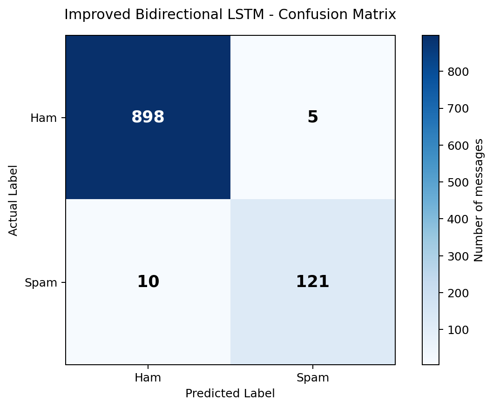

# SMS Spam Classification using Deep Learning

A Deep Learning project that classifies SMS messages into **Spam** and **Ham (normal messages)** using Natural Language Processing (NLP) and a Bidirectional LSTM model.

## Project Overview

The goal of this project is to identify unwanted or suspicious SMS messages automatically. Two neural-network approaches were trained and compared:

1. **Initial Neural Network** – Embedding, Global Average Pooling, Dense layers, Batch Normalization, and Dropout.
2. **Improved Bidirectional LSTM** – Embedding, Bidirectional LSTM, Dense layer, Batch Normalization, and Dropout.

The improved Bidirectional LSTM performed better on the held-out test dataset.

## Dataset

- **Dataset name:** SMS Spam Collection
- **Source:** UCI Machine Learning Repository
- **Dataset page:** https://archive.ics.uci.edu/dataset/228/sms+spam+collection
- **Original dataset size:** 5,572 SMS messages
- **Duplicate messages removed:** 403
- **Final dataset size:** 5,169 unique messages

### Class distribution after duplicate removal

| Label | Meaning | Messages |
|---|---|---:|
| ham | Normal SMS | 4,516 |
| spam | Unwanted / spam SMS | 653 |
| **Total** | | **5,169** |

The dataset is downloaded from the UCI source by the notebook. The notebook reads the `SMSSpamCollection` file, which contains the message label and message text.

## Technologies Used

- Python
- Google Colab
- Pandas and NumPy
- TensorFlow / Keras
- Scikit-learn
- Matplotlib
- Seaborn

## Project Workflow

1. Download the SMS Spam Collection dataset.
2. Inspect the dataset, missing values, duplicates, and class distribution.
3. Remove duplicate messages.
4. Clean text by converting it to lowercase, removing punctuation, and normalizing whitespace. Numeric characters are preserved.
5. Encode labels: `ham = 0`, `spam = 1`.
6. Split the data into training and testing sets using an 80/20 split with stratification.
7. Fit the tokenizer on training text only, convert messages to integer sequences, and pad/truncate sequences to 100 tokens.
8. Train and compare the initial Neural Network and improved Bidirectional LSTM.
9. Evaluate the models using accuracy, precision, recall, F1 score, and a confusion matrix.
10. Test the improved model with new SMS examples.

## Models

### 1. Initial Neural Network

Architecture:

- Embedding
- GlobalAveragePooling1D
- Dense (64 units, ReLU)
- Batch Normalization
- Dropout (0.3)
- Dense (32 units, ReLU)
- Dropout (0.2)
- Dense (1 unit, Sigmoid)

### 2. Improved Bidirectional LSTM

**Selected model:** Bidirectional LSTM

Architecture:

- Embedding (`output_dim=32`)
- Bidirectional LSTM (32 units in each direction)
- Dense (32 units, ReLU)
- Batch Normalization
- Dropout (0.4)
- Dense (1 unit, Sigmoid)

Training configuration:

- Optimizer: Adam
- Loss function: Binary Crossentropy
- Maximum epochs: 15
- Batch size: 32
- Validation split: 20% of the training data
- Early stopping: monitors validation loss, patience 3, restores best weights
- Class weights: balanced weights calculated from the training labels

## Model Comparison

The following are the reported results on the held-out test set:

| Model | Accuracy | Precision | Recall | F1 Score |
|---|---:|---:|---:|---:|
| Initial Neural Network | 97.49% | 95.65% | 83.97% | 89.43% |
| **Improved Bidirectional LSTM** | **98.55%** | **96.03%** | **92.37%** | **94.16%** |

The Bidirectional LSTM achieved higher scores across all four reported metrics.

## Final Evaluation – Bidirectional LSTM

| Metric | Ham | Spam |
|---|---:|---:|
| Precision | 0.99 | 0.96 |
| Recall | 0.99 | 0.92 |
| F1 score | 0.99 | 0.94 |
| Support | 903 | 131 |

- **Accuracy:** 98.55%
- **Test messages:** 1,034
- **Correct predictions:** 1,019
- **Incorrect predictions:** 15

### Confusion Matrix



Confusion matrix values (rows are actual labels; columns are predicted labels):

| Actual \ Predicted | Ham | Spam |
|---|---:|---:|
| Ham | 898 | 5 |
| Spam | 10 | 121 |

Interpretation:

- **898** normal messages were correctly classified as Ham.
- **5** normal messages were incorrectly classified as Spam.
- **10** Spam messages were incorrectly classified as Ham.
- **121** Spam messages were correctly classified as Spam.

## Sample Predictions

The improved model was also tested with three new SMS messages:

| SMS example | Prediction | Reported confidence |
|---|---|---:|
| "Congratulations! You won a free prize. Claim now!" | Spam | 99.96% |
| "Hey, are you coming to college tomorrow?" | Ham | 99.56% |
| "URGENT! You have won a cash reward. Call now!" | Spam | 99.92% |

Confidence is the model's estimated probability for its predicted class. It is not a guarantee that a prediction is correct.

## How to Run

1. Download or clone this repository.
2. Open `Deep_Learning_SMS_Classifier.ipynb` in Google Colab.
3. Run the notebook cells from top to bottom.
4. The notebook downloads the dataset from the UCI repository.
5. Install any missing packages if Colab requests them.
6. Train the models and review the evaluation metrics and sample predictions.

Google Colab: https://colab.research.google.com/

## Suggested Repository Structure

```text
sms-spam-deep-learning-classifier/
│
├── Deep_Learning_SMS_Classifier.ipynb
├── README.md
└── assets/
    └── confusion_matrix.png
```

## Conclusion

This project demonstrates how NLP preprocessing and Deep Learning can be used for SMS spam detection. The initial Neural Network achieved 97.49% test accuracy, while the improved Bidirectional LSTM achieved 98.55% test accuracy and a 94.16% F1 score on the selected test split. The Bidirectional LSTM performed better in this experiment, particularly in identifying Spam messages.

These results apply to this dataset and test split; performance on messages from other sources may differ.
